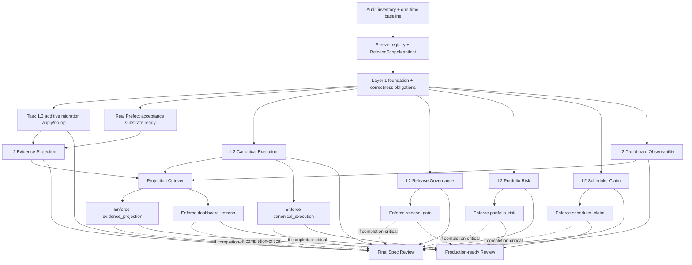

# 生产证据、执行一致性与风险加固设计文档

## Overview

### 1. 目的与阶段边界

本文将 `production-evidence-risk-hardening` 设计与修订后的 Requirements 1–13 对齐，重点收口发布范围、稳定注册表、证据分层、预登记清单、Task 1.3 revision 绑定、正确性义务和并行依赖图。

本阶段只更新设计文档：

- 不实现或修改产品代码、迁移、测试、运行配置和 `tasks.md`。
- 不执行 MySQL DDL/DML、Classification_Backfill、Projection_Cutover 或任何 Production_Enforcement_Switch。
- 不启动或改变 Prefect server、worker、work pool、queue、deployment 或 schedule。
- 不读取、写入、传输或调用券商 credential、account、position、balance 或 order。
- 不把当前 provenance-clean true-forward `n=0` 解释为策略有效性结论。

### 1.1 本次设计协调结论

| 既有设计问题 | 修订后的设计决定 |
|---|---|
| 发布范围仅有概念，没有可执行的不可变模型 | 新增内容寻址的 `ReleaseScopeManifest`、固定操作注册表、严格校验和确定性完成算法 |
| 未授权操作可能被误当作完成阻塞项 | `EXCLUDED` 操作固定为 `NOT_AUTHORIZED_NOT_EXECUTED`，从完成集合排除；Task 1.3 migration 永远不能排除 |
| Feature Flag、Layer 2 证据和 cutover 依赖分散 | 使用恰好六行的集中式 `FeatureFlagRegistry`，禁止部署时替换稳定 ID 或依赖 |
| Evidence scope 与研究路径混合 | 使用两个正交枚举，并以显式布尔合取产生 `Release_Eligibility_Decision` |
| 后续环境任务可能“刷新”基线 | S0 只允许一次性、行为变化前冻结 `Baseline_Artifact`；以后只追加 `Baseline_Verification_Evidence` |
| 阈值、环境、命令和证据位置可在结果出现后改变 | 五类 `PreRegisteredManifest` 在各自触发点前冻结，并通过 URI、schema、hash、revision 和时间顺序验真 |
| 带 `*` 的属性测试任务容易被误解为证据可选 | 只有测试编写任务可选；每个 `Correctness_Obligation` 的成功证据不可选，替代证据必须通过 revision-bound 等价审计 |
| Task 1.3 的 `CODE_COMPLETE` 可能跨依赖变更继续沿用 | `Task_1_3_Revision_Binding` 绑定六类依赖；任一哈希变化立即失效，重新 Layer 1 后才恢复 |
| “每次最多首次 enforce 一个路径”造成无必要串行 | 删除全局串行批准概念，改用显式 DAG；相互独立的 Layer 2 和 enforcement 节点可并行，最终统一 fan-in 审核 |

### 1.2 不可放宽的既有边界

1. 所有 Historical_Record、原始时间、业务 payload、outcome version 和审计事实均 append-only；不得删除、覆盖或伪造历史时间。
2. migration 只允许兼容的 `CREATE TABLE`、`ADD COLUMN`、`CREATE INDEX`；恢复使用 forward fix 或 Read_Path_Rollback，不提供 destructive downgrade。
3. Separate_Write_Approval 只授权一个操作实例、一个环境和一个计划身份，不传递给其他操作。
4. D1 全量历史回填、D2 新 alpha、D3 券商 live trading 继续属于独立倡议。
5. 本 Spec 的 Risk_System 只覆盖 recommendation、simulation、paper 和 shadow portfolio。

## Design Principles

### 2. 核心不变量

1. **内容寻址且不可变**：manifest、revision binding、baseline、evidence、assessment 和 decision 的身份由 canonical payload hash 决定；变更产生新身份，旧记录永久可解析。
2. **状态正交**：`Code_State`、`Environment_Acceptance_State`、`Operation_Execution_State`、`Production_Activation_State` 和 runtime flag mode 不互相推导。
3. **范围先于行为**：首个 Behavior_Changing_Work 前必须冻结 baseline、release scope 和适用预登记清单。
4. **证据先于声明**：Layer 1 不能代替 Layer 2，mock 不能代替真实 MySQL/Prefect，未绑定当前 revision 的证据不能产生通过状态。
5. **完成不等于生产就绪**：Spec 可以在部分 activation-only/excluded 操作未激活时完成；production-ready 必须同时满足六个 `ACTIVE` 和六个 `ENFORCE`。
6. **最小依赖、最大并行**：DAG 只表达真实依赖；不存在全局“先批准一个开关再批准下一个”的人工串行锁。
7. **失败关闭**：未知 ID、hash 不匹配、环境漂移、命令漂移、阈值漂移、证据缺失、secret 泄漏风险和券商访问均拒绝继续。

## Architecture

### 3. 分层架构

```text
┌────────────────────────────── Governance Plane ──────────────────────────────┐
│ AuditInventory ─ ReuseDecision ─ GapRecord ─ TraceabilityMatrix             │
│       │                 │                         │                           │
│       ├─ BaselineArtifact + append-only verification                         │
│       ├─ ReleaseScopeManifest + stable registries                            │
│       ├─ RevisionBinding + CodeState invalidation                             │
│       └─ SeparateWriteApproval + dependency DAG                               │
└───────────────────────────────────┬───────────────────────────────────────────┘
                                    │ immutable identities
┌────────────────────────────── Business Logic Plane ──────────────────────────┐
│ EvidenceIdentity ─ HistoricalQuery ─ LIVE selectors                          │
│ CanonicalExecutionCore ─ OutcomeVersion ─ CurrentProjection                  │
│ ReleaseEligibility ─ DataQualityDecision ─ PortfolioRiskGate                 │
│ ScheduledOccurrence/Claim ─ DashboardProjection                              │
└───────────────────────────────────┬───────────────────────────────────────────┘
                                    │ preregistered acceptance contracts
┌────────────────────────────── Acceptance Plane ──────────────────────────────┐
│ ShadowThreshold / RestoreCapacity / Layer2Evidence manifests                 │
│ RealEnvironmentIdentity / AcceptanceCommand manifests                        │
│ CorrectnessObligation ─ PropertyEvidence | EquivalentEvidence                │
│ Layer 1 evidence ─ Real MySQL/Prefect Layer 2 evidence ─ CompletionEvaluator │
└───────────────────────────────────────────────────────────────────────────────┘
```

## Components and Interfaces

### 3.1 组件与接口边界

| 组件 | 权威输入 | 权威输出 | 明确不负责 |
|---|---|---|---|
| `GovernanceSystem` | registries、audit facts、manifest、approval、event log | scope/status/decision identities | 生成业务绩效或伪造验收证据 |
| `EvidenceSystem` | trusted source、snapshot、provenance | evidence identity、历史查询、LIVE eligibility | 根据 UI 名称改写证据类型 |
| `ExecutionSystem` | recommendation、bars、ExecutionPolicy | canonical execution result | 发布资格和授权 |
| `ReleaseGovernanceSystem` | evidence package、scope/path、identity、thresholds | deterministic eligibility/champion decisions | 修改策略结果或 holdout population |
| `DataQualitySystem` | strategy data contract、observations | READY/DEGRADED/BLOCKED | 在 required data 缺失时继续 formal run |
| `OutcomeSystem` | recommendation identity、snapshot、policy、code、label | append-only versions、atomic current pointer | 删除 duplicate/orphan history |
| `RiskSystem` | policy、state、position request | ALLOW/REDUCE/REJECT/HALT + reservation | 访问券商资源或自动恢复 halt |
| `SchedulerSystem` | occurrence、lease、Prefect state | one owner/claim、typed terminal state | 用进程内集合替代数据库唯一性 |
| `ObservabilitySystem` | accepted projections、correlation facts | truthful dashboard/alerts | 把 reconstruction 标成 LIVE |
| `MigrationSystem` | exact plan、manifest、approval、safety checks | additive apply/backfill/cutover evidence | 通用数据库写权限或 destructive rollback |
| `AcceptanceSystem` | preregistered contracts、immutable evidence | Layer 1/2 status、completion decision | 用测试名称或人工口头确认推断通过 |
| `ScopeGuardSystem` | requested initiative/resource | allow/deny + redacted audit | D1/D2/D3 或 Brokerage_Access |

## Data Models

### 4. 内容寻址信封

以下 Python 仅描述目标契约，不是本阶段实现：

```python
from dataclasses import dataclass
from datetime import datetime
from typing import Literal

@dataclass(frozen=True)
class ImmutableEnvelope:
    object_id: str                 # "<kind>:sha256:<canonical_payload_hash>"
    kind: str
    schema_version: str
    payload_sha256: str
    created_at: datetime
    created_by: str
    code_revision: str
    supersedes_id: str | None
    referenced_object_ids: tuple[str, ...]
```

统一规则：

- canonical serialization 使用 UTF-8、排序键、明确时区、decimal 字符串和无隐式默认值。
- `object_id`、`payload_sha256` 或 canonical payload 任一不一致即拒绝解析。
- immutable object 不提供 update；修订通过 `supersedes_id` 追加新对象。
- 所有 URI 必须解析到 immutable version，并验证内容 hash；禁止把 `latest`、可覆盖路径或未版本化数据库查询当作证据 URI。
- 时间由受审计时钟源记录；时间顺序不能证明时保持 `BLOCKED`，不得推测。

## Central Registries

### 5. Feature Flag、Layer 2 Evidence 与 cutover 依赖注册表

```python
class FeatureFlagId(str): ...
class Layer2EvidenceSetId(str): ...

@dataclass(frozen=True)
class FeatureFlagRegistryEntry:
    feature_flag_id: FeatureFlagId
    layer_2_evidence_set_id: Layer2EvidenceSetId
    projection_cutover_dependency: str | None
    evidence_contract: tuple[str, ...]

FEATURE_FLAG_REGISTRY: tuple[FeatureFlagRegistryEntry, ...] = (
    FeatureFlagRegistryEntry(
        "evidence_projection",
        "L2_FLAG_EVIDENCE_PROJECTION_V1",
        "projection_cutover.production_read_v1",
        ("migration_apply_no_op", "real_prefect_replay",
         "persisted_historical_query", "persisted_live_exclusion"),
    ),
    FeatureFlagRegistryEntry(
        "canonical_execution",
        "L2_FLAG_CANONICAL_EXECUTION_V1",
        None,
        ("real_mysql_three_path_outcomes", "execution_parity", "t_plus_one",
         "append_only_old_versions_readable"),
    ),
    FeatureFlagRegistryEntry(
        "release_gate",
        "L2_FLAG_RELEASE_GOVERNANCE_V1",
        None,
        ("persisted_profile_ledger_package", "holdout_single_use_freeze",
         "identity_and_permission_denials"),
    ),
    FeatureFlagRegistryEntry(
        "portfolio_risk",
        "L2_FLAG_PORTFOLIO_RISK_V1",
        None,
        ("reservation", "rollback", "halt", "locked_exposure",
         "concurrent_no_overallocation"),
    ),
    FeatureFlagRegistryEntry(
        "scheduler_claim",
        "L2_FLAG_SCHEDULER_CLAIM_V1",
        None,
        ("owner", "concurrency", "claim", "lease", "retry", "misfire",
         "reconciliation"),
    ),
    FeatureFlagRegistryEntry(
        "dashboard_refresh",
        "L2_FLAG_DASHBOARD_OBSERVABILITY_V1",
        "projection_cutover.production_read_v1",
        ("current_stale_labels", "lifecycle", "correlation", "alert_inputs"),
    ),
)
```

注册表验证器必须同时证明：

1. ID 集合与上述六个值完全相等，数量恰好为六且无重复。
2. 每个 Layer 2 ID 唯一绑定一个 Feature Flag。
3. cutover dependency 与表中值逐字相等；`None` 等价于规范值 `NONE`。
4. 状态按 flag 独立保存；更新一个 flag 不改变其他五个。
5. Registry snapshot 自身内容寻址，并被 ReleaseScopeManifest、Layer2EvidenceManifest 和 activation decision 引用。

### 5.1 Approval-Gated Operation Registry

| Operation ID | 类型 | 固定规则 | Layer 2 角色 | 直接依赖 |
|---|---|---|---|---|
| `migration_apply.task_1_3_schema_v1` | migration apply | 永远 `INCLUDED + COMPLETION_CRITICAL` | 产生 `L2_FLAG_EVIDENCE_PROJECTION_V1` 的 migration/no-op 部分 | restore/capacity/preconditions |
| `classification_backfill.provenance_v1` | backfill | 显式 included/excluded | 产生 evidence projection 的 preservation/no-op 部分 | Task 1.3 schema migration |
| `projection_cutover.production_read_v1` | cutover | 显式 included/excluded | 消费 evidence/canonical/dashboard Layer 2 和 shadow results | 预登记 shadow thresholds |
| `enforcement.evidence_projection` | enforcement | 显式 included/excluded | 消费 `L2_FLAG_EVIDENCE_PROJECTION_V1` | production read cutover |
| `enforcement.canonical_execution` | enforcement | 显式 included/excluded | 消费 `L2_FLAG_CANONICAL_EXECUTION_V1` | `NONE` |
| `enforcement.release_gate` | enforcement | 显式 included/excluded | 消费 `L2_FLAG_RELEASE_GOVERNANCE_V1` | `NONE` |
| `enforcement.portfolio_risk` | enforcement | 显式 included/excluded | 消费 `L2_FLAG_PORTFOLIO_RISK_V1` | `NONE` |
| `enforcement.scheduler_claim` | enforcement | 显式 included/excluded | 消费 `L2_FLAG_SCHEDULER_CLAIM_V1` | `NONE` |
| `enforcement.dashboard_refresh` | enforcement | 显式 included/excluded | 消费 `L2_FLAG_DASHBOARD_OBSERVABILITY_V1` | production read cutover |

发现新的 migration apply 实例时，不得临时复用上述 ID。必须先创建新的稳定 operation ID、registry revision 和 ReleaseScopeManifest revision；旧 manifest 与完成判定保留但失效。

## Release Scope and Completion

### 6. 不可变 ReleaseScopeManifest

```python
ReleaseInclusion = Literal["INCLUDED", "EXCLUDED"]
CompletionImpact = Literal["COMPLETION_CRITICAL", "ACTIVATION_ONLY"]
EvidenceBindingRole = Literal["PRODUCES", "CONSUMES"]

@dataclass(frozen=True)
class Layer2EvidenceBinding:
    evidence_set_id: str
    role: EvidenceBindingRole

@dataclass(frozen=True)
class ReleaseScopeEntry:
    operation_id: str
    release_inclusion: ReleaseInclusion
    completion_impact: CompletionImpact
    target_environment_manifest_id: str
    operation_plan_id: str
    evidence_bindings: tuple[Layer2EvidenceBinding, ...]
    dependency_operation_ids: tuple[str, ...]
    declaration_reason_code: str

@dataclass(frozen=True)
class ReleaseScopeManifest:
    envelope: ImmutableEnvelope
    registry_snapshot_id: str
    entries: tuple[ReleaseScopeEntry, ...]
    behavior_change_barrier_id: str
    frozen_at: datetime
```

`ReleaseScopeManifest` 即使把操作设为 `EXCLUDED`，仍绑定本次发布目标环境和被排除的计划身份，避免“排除哪个环境/哪个计划”含糊。它只声明范围，不是 Separate_Write_Approval。

#### 6.1 校验算法

```python
def validate_release_scope(manifest, operation_registry, registry_snapshot):
    assert manifest.registry_snapshot_id == registry_snapshot.object_id
    assert set(entry.operation_id for entry in manifest.entries) == set(operation_registry)
    assert len(manifest.entries) == len(operation_registry)  # 无重复

    migration = entry_for(manifest, "migration_apply.task_1_3_schema_v1")
    assert migration.release_inclusion == "INCLUDED"
    assert migration.completion_impact == "COMPLETION_CRITICAL"

    for entry in manifest.entries:
        assert entry.operation_id in operation_registry
        assert not (
            entry.release_inclusion == "EXCLUDED"
            and entry.completion_impact == "COMPLETION_CRITICAL"
        )
        assert bindings_match_registry(entry, operation_registry[entry.operation_id])
        assert dependencies_are_acyclic_and_registered(entry)
        assert immutable_ref_resolves(entry.target_environment_manifest_id)
        assert immutable_ref_resolves(entry.operation_plan_id)

    assert manifest.frozen_at < behavior_change_started_at(manifest.behavior_change_barrier_id)
```

缺项、重复、未知 ID、非法组合、registry mismatch、不可解析引用、依赖环或冻结顺序不可证明时，manifest 整体无效；任何 Approval_Gated_Operation executor 都不可到达。

### 6.2 Operation 状态投影

```python
def initialize_operation_states(manifest):
    states = {}
    for entry in manifest.entries:
        states[entry.operation_id] = (
            "NOT_AUTHORIZED_NOT_EXECUTED"
            if entry.release_inclusion == "EXCLUDED"
            else "PLANNED"
        )
    return states
```

状态转换仅允许：

```text
INCLUDED: PLANNED
          → NOT_AUTHORIZED
          → AUTHORIZED_NOT_EXECUTED
          → EXECUTED
          → ACCEPTED | FAILED

EXCLUDED: NOT_AUTHORIZED_NOT_EXECUTED   (该 manifest revision 下终态)
```

`EXCLUDED` 不会因没有授权而变为 `NOT_AUTHORIZED`，也不会阻塞 Spec。若要执行，必须创建新 scope manifest identity，将其改为 `INCLUDED`，并重新完成所有预登记与依赖校验。

### 6.3 Completion_Required_Work_Set

```python
def build_completion_required_work_set(non_gated_required_work, manifest):
    gated = {
        entry.operation_id
        for entry in manifest.entries
        if entry.release_inclusion == "INCLUDED"
        and entry.completion_impact == "COMPLETION_CRITICAL"
    }
    return frozenset(non_gated_required_work) | frozenset(gated)


def evaluate_spec_completion(non_gated_statuses, operation_states, manifest):
    validate_release_scope(manifest, APPROVAL_OPERATION_REGISTRY, current_registry())
    required = build_completion_required_work_set(non_gated_statuses.keys(), manifest)

    for subject_id in sorted(required):
        accepted = (
            non_gated_statuses[subject_id].environment_state == "ACCEPTED"
            if subject_id in non_gated_statuses
            else operation_states[subject_id] == "ACCEPTED"
        )
        if not accepted:
            return CompletionDecision("BLOCKED", (f"NOT_ACCEPTED:{subject_id}",))

    return CompletionDecision("COMPLETE", ())
```

确定性规则：

- `migration_apply.task_1_3_schema_v1` 必然在完成集合中。
- `EXCLUDED` 操作和所有 `ACTIVATION_ONLY` 操作不进入完成集合。
- included completion-critical 操作没有授权时为 `NOT_AUTHORIZED`，因此 Spec 保持 `BLOCKED`。
- operation 执行失败保留 `FAILED` attempt，但 Spec 完成判定保持 `BLOCKED`，等待新计划/新授权/新 attempt；不得把失败当作已完成。
- manifest revision 变化后，旧 CompletionDecision 标记 `STALE_MANIFEST_BINDING`，必须用新 identity 重算。

### 6.4 Production-ready 判定

```python
def production_ready(flag_runtime_modes, activation_states, registry):
    required = {row.feature_flag_id for row in registry}
    return (
        set(flag_runtime_modes) == required
        and set(activation_states) == required
        and all(flag_runtime_modes[flag_id] == "ENFORCE" for flag_id in required)
        and all(activation_states[flag_id] == "ACTIVE" for flag_id in required)
    )
```

该判定不因 Spec `COMPLETE`、scope exclusion 或 activation-only 配置而放宽。任一 flag 缺失、非 `ENFORCE` 或非 `ACTIVE` 都拒绝“production ready”。

## Baseline and Revision Binding

### 7. S0 Baseline_Artifact 与后续验证证据

```python
@dataclass(frozen=True)
class BaselineArtifact:
    envelope: ImmutableEnvelope
    captured_at: datetime
    capture_code_revision: str
    workspace_revision: str
    workspace_status_digest: str
    active_strategy_ids: tuple[str, ...]
    strategy_policy_fingerprints: tuple[str, ...]
    execution_policy_fingerprints: tuple[str, ...]
    champion_identity: str | None
    projection_count_snapshot: tuple[tuple[str, int], ...]
    query_summary_hashes: tuple[str, ...]
    prefect_control_plane_identity_hash: str
    golden_sample_hashes: tuple[str, ...]
    first_behavior_change_event_id: str

@dataclass(frozen=True)
class BaselineVerificationEvidence:
    envelope: ImmutableEnvelope
    baseline_artifact_id: str
    attempt_id: str
    real_environment_manifest_id: str
    verifier_code_revision: str
    observed_reference_hash: str
    environment_correspondence_hash: str
    result: Literal["PASS", "FAIL", "BLOCKED"]
    reason_codes: tuple[str, ...]
```

基线算法：

1. 事件日志先登记 `BASELINE_CAPTURE_STARTED`，只读采集并创建一个内容寻址 artifact。
2. 冻结 artifact 后登记 `BASELINE_FROZEN`；首个 Behavior_Changing_Work 必须引用该 identity。
3. `captured_at < first_behavior_change.started_at` 无法证明时，S0 环境状态保持 `BLOCKED`，reason=`BASELINE_FREEZE_ORDER_UNPROVEN`。
4. 后续任务只能验证原 identity/hash/环境对应关系并追加 verification attempt；不得重采集、覆盖或把新环境观察写入原 baseline。
5. 请求 recapture/overwrite 时返回 `BASELINE_IMMUTABLE`，同时追加不含敏感值的治理审计事件。

现有 `baseline-task-0.1.json` 与 `baseline-task-7.1.json` 先作为 Existing_Artifact 进入审计；是否能成为规范 Baseline_Artifact 取决于其冻结顺序、hash 和 capture revision 是否可证明，而不是文件名。

### 7.1 Task_1_3_Revision_Binding

```python
Task13DependencyKind = Literal[
    "REPLAY",
    "EVIDENCE_IDENTITY",
    "HISTORICAL_QUERY",
    "LIVE_SELECTOR",
    "MIGRATION_CONTRACT",
    "ASSOCIATED_TESTS",
]

@dataclass(frozen=True)
class DependencyDigest:
    kind: Task13DependencyKind
    locator: str                  # path + symbol/test/contract identity
    content_sha256: str

@dataclass(frozen=True)
class RevisionBinding:
    envelope: ImmutableEnvelope
    task_id: str
    code_revision: str
    dependency_digests: tuple[DependencyDigest, ...]
    layer_1_suite_manifest_id: str
    layer_1_result_evidence_ids: tuple[str, ...]
    correctness_obligation_ids: tuple[str, ...]
```

每种依赖类型至少一项，tuple 按 `(kind, locator)` 排序后进入 binding hash。Task 1.3 的已知 locator 至少覆盖：

- `replay_all_days.py` 的 replay entrypoint 和写入路径；
- evidence identity builder、EvidenceClass/RunSource contract；
- Historical_Query 的 service/adapter contract；
- 所有 LIVE_KPI、forward gate、ledger、champion selector；
- `0004_evidence_provenance.py` 或经审计等价 migration contract；
- replay、identity、query、LIVE exclusion 和 migration 关联测试及 fixtures。

#### 7.2 失效与重新验证算法

```python
def reconcile_task_1_3(current_dependency_digests, status, binding):
    if canonical_hash(current_dependency_digests) != canonical_hash(binding.dependency_digests):
        return status.replace(
            code_state="IN_PROGRESS",
            layer_1_evidence_ids=(),
            blocker_codes=union(status.blocker_codes, {"REVISION_BINDING_STALE"}),
        )
    return status


def accept_new_task_1_3_binding(new_binding, layer_1_validation):
    require_exact_dependency_kinds(new_binding)
    require_current_hashes(new_binding)
    require_all_correctness_obligations(layer_1_validation)
    require(layer_1_validation.result == "PASS")
    return "CODE_COMPLETE"
```

- 旧 binding、旧 Layer 1 evidence 和旧 Layer 2 attempts 永久保留，但不再支持当前状态。
- 依赖 hash 变化不会改变 Environment_Acceptance_State；它会使当前 code state 回到 `IN_PROGRESS`。
- 新 binding Layer 1 通过后，Code_State 才恢复 `CODE_COMPLETE`。
- Task 1.3 当前 Environment_Acceptance_State 继续为 `BLOCKED`，直到四类 revision-matched 证据全部存在：真实 MySQL migration/no-op、Real Prefect replay、持久化 Historical_Query、持久化 LIVE exclusion。
- Classification_Backfill 既不是 Task 1.3 新写路径的前置条件，也不能替代上述四类证据。

## Evidence, Research, and Release Decision

### 8. Evidence identity 与历史保留

`CompleteProvenance` 至少包含 Evidence_Class、Actual_Generated_At、Signal_Date、Trade_Date、Data_As_Of、Source_Snapshot_ID、Policy_Fingerprint、Execution_Policy_Fingerprint、Code_Revision、Run_Source 和适用的 Reconstruction_Batch_Identity。

数据流：

```text
trusted Run_Source
→ provenance builder
→ append-only run/recommendation/outcome/candidate-audit
→ Historical_Query by Signal_Date/Trade_Date
→ class-labeled historical projection

same append-only store
→ strict LIVE predicate
→ LIVE_KPI / forward gate / True_Forward_Ledger / champion evidence
```

strict LIVE predicate 不读取 run name、evaluation scope 或被改写的时间字段。无法证明的 legacy record 为 `UNVERIFIED`；目标日之后创建的重建为 `HISTORICAL_RECONSTRUCTION`。Classification_Backfill 只能写新增 classification/provenance/reason/legacy-audit 字段，且第二次执行 no-op。

### 8.1 Evidence_Scope 与 Research_Path_Classification 正交

```python
EvidenceScope = Literal[
    "TRAIN", "VALIDATION", "PURGED_HISTORICAL_OOS",
    "UNTOUCHED_HOLDOUT", "SHADOW_FORWARD", "LIVE_CANARY",
]
ResearchPathClassification = Literal["GOVERNED_RELEASE", "EXPLORATORY", "PATH_A"]

@dataclass(frozen=True)
class ReleaseEligibilityInput:
    evidence_scope: EvidenceScope
    research_path: ResearchPathClassification
    production_eligibility: bool
    research_family_id: str
    complete_provenance_id: str
    evidence_package_id: str
    current_policy_id: str
    current_state_id: str
    current_deployment_id: str
    preregistered_gate_manifest_id: str

@dataclass(frozen=True)
class ReleaseEligibilityDecision:
    envelope: ImmutableEnvelope
    input_snapshot: ReleaseEligibilityInput
    eligible: bool
    gate_results: tuple[tuple[str, bool], ...]
    reason_codes: tuple[str, ...]
```

两个枚举分别持久化，允许形成笛卡尔积，不能互相覆盖或把 `PATH_A` 当作 scope。`EXPLORATORY` 或 `PATH_A` 强制 `production_eligibility=False`。

### 8.2 确定性 Release_Eligibility_Decision

```python
def decide_release_eligibility(request, family, package, current, thresholds):
    if not valid_scope(request.evidence_scope) or not valid_path(request.research_path):
        return invalid("RELEASE_CLASSIFICATION_INVALID")

    gates = (
        ("SCOPE_ALLOWED", request.evidence_scope in family.allowed_evidence_scopes),
        ("GOVERNED_PATH", request.research_path == "GOVERNED_RELEASE"),
        ("PRODUCTION_ELIGIBLE", request.production_eligibility is True),
        ("PROVENANCE_VALID", complete_provenance_valid(request.complete_provenance_id)),
        ("PACKAGE_MATCH", package.identity == request.evidence_package_id),
        ("CURRENT_POLICY_MATCH", package.policy_id == current.policy_id),
        ("CURRENT_STATE_MATCH", package.state_id == current.state_id),
        ("CURRENT_DEPLOYMENT_MATCH", package.deployment_id == current.deployment_id),
        ("MIN_TRADES", package.n >= thresholds.minimum_trades),
        ("MIN_DISTINCT_DAYS", package.distinct_days >= thresholds.minimum_distinct_days),
        ("MIN_COVERAGE", package.coverage >= thresholds.minimum_coverage),
        ("CONFIDENCE", confidence_gate(package, thresholds)),
        ("MDD_REGRESSION", mdd_gate(package, thresholds)),
        ("MULTIPLE_TESTING", correction_gate(package, thresholds)),
    )
    eligible = all(value for _, value in gates)
    reasons = tuple(code for code, value in gates if not value)  # 固定表顺序
    return persist_immutable_decision(request, gates, eligible, reasons)
```

相同 canonical inputs 必须得到相同 decision identity、布尔结果和 reason code 顺序。Research proposal 权限与 formal publish 权限在独立 role/action matrix 中校验；eligibility 为 true 也不会绕过 publish authority。

## Preregistered Acceptance Contracts

### 9. 公共 manifest header

```python
@dataclass(frozen=True)
class PreRegisteredManifestHeader:
    envelope: ImmutableEnvelope
    stable_manifest_key: str
    applies_to_code_revision: str
    registry_snapshot_id: str
    frozen_at: datetime
    supersedes_manifest_id: str | None
    secret_handle_ids: tuple[str, ...]
```

所有 manifest 使用 JSON Schema（或等价不可变 schema artifact）验证；schema URI 本身携带 immutable version/hash。替代 manifest 追加新 identity，旧 manifest 和所有 attempts 保留。

### 9.1 Shadow_Threshold_Manifest

```python
Comparator = Literal["LT", "LTE", "EQ", "GTE", "GT"]

@dataclass(frozen=True)
class ShadowThresholdRule:
    metric_id: str
    comparator: Comparator
    threshold_decimal: str
    aggregation: str
    sample_window_start: datetime
    sample_window_end: datetime
    minimum_sample_size: int
    identity_dimensions: tuple[str, ...]
    failure_action: Literal["BLOCK_CUTOVER", "ROLLBACK_READ_PATH", "ALERT_ONLY"]

@dataclass(frozen=True)
class ShadowThresholdManifest:
    header: PreRegisteredManifestHeader
    target_operation_id: str
    source_projection_id: str
    candidate_projection_id: str
    rules: tuple[ShadowThresholdRule, ...]
```

必须在首个 shadow 样本前冻结。窗口、样本量、方向或阈值变化均创建新 identity；旧样本不能被重新解释为新 manifest 的预登记样本。

### 9.2 Restore_Capacity_Criteria_Manifest

```python
@dataclass(frozen=True)
class RestorePointCriteria:
    required_scope_ids: tuple[str, ...]
    maximum_age_seconds: int
    restore_verification_evidence_schema_uri: str
    require_successful_restore_drill: bool

@dataclass(frozen=True)
class CapacityCriterion:
    metric_id: Literal[
        "DISK_FREE_BYTES", "TEMP_FREE_BYTES", "TABLE_BYTES", "INDEX_BYTES",
        "PROJECTED_GROWTH_BYTES", "MAX_LOCK_SECONDS", "SAFETY_MARGIN_RATIO",
    ]
    comparator: Comparator
    threshold_decimal: str

@dataclass(frozen=True)
class RestoreCapacityCriteriaManifest:
    header: PreRegisteredManifestHeader
    target_environment_manifest_id: str
    migration_plan_id: str
    restore: RestorePointCriteria
    capacity_rules: tuple[CapacityCriterion, ...]
```

必须在 migration preflight 前冻结。真实观测写入独立 evidence attempt，不回写 criteria。

### 9.3 Layer_2_Evidence_Manifest

```python
@dataclass(frozen=True)
class EvidenceArtifactContract:
    artifact_type: str
    schema_uri: str
    uri_scheme_allowlist: tuple[str, ...]
    required_uri_pattern: str
    hash_algorithm: Literal["SHA-256"]
    canonicalization_id: str
    required_fields: tuple[str, ...]

@dataclass(frozen=True)
class AssertionContract:
    assertion_id: str
    oracle_id: str
    severity: Literal["REQUIRED", "INFORMATIONAL"]

@dataclass(frozen=True)
class Layer2EvidenceManifest:
    header: PreRegisteredManifestHeader
    layer_2_evidence_set_id: str
    real_environment_manifest_id: str
    acceptance_command_ids: tuple[str, ...]
    artifact_contracts: tuple[EvidenceArtifactContract, ...]
    assertions: tuple[AssertionContract, ...]
    pass_rule: Literal["ALL_REQUIRED_ASSERTIONS_PASS"]
```

`Evidence_URI` 只允许不可变地址，例如 `evidence://sha256/<digest>` 或启用 object-version 的受控存储 URI。验证器必须解析 URI、读取 bytes、按 schema 解析并重新计算 hash；只保存网页链接、日志搜索条件或可变文件路径不构成证据。

### 9.4 Real_Environment_Identity_Manifest

```python
@dataclass(frozen=True)
class MySQLIdentity:
    server_uuid_hash: str
    endpoint_alias: str
    port: int
    database_name: str
    engine_version: str
    tls_peer_fingerprint: str | None

@dataclass(frozen=True)
class PrefectIdentity:
    api_endpoint_hash: str
    server_version: str
    metadata_database_identity_hash: str
    work_pool_id: str
    queue_id: str
    worker_id: str
    deployment_id: str

@dataclass(frozen=True)
class RealEnvironmentIdentityManifest:
    header: PreRegisteredManifestHeader
    environment_id: str
    mysql: MySQLIdentity
    prefect: PrefectIdentity
    sanitized_network_target_ids: tuple[str, ...]
```

endpoint 只保存去敏 alias/hash；认证材料只通过 secret handle 注入，manifest 和 evidence 不保存 secret value。

### 9.5 Acceptance_Command_Manifest

```python
@dataclass(frozen=True)
class AcceptanceCommand:
    command_id: str
    executable_entrypoint: str
    argument_vector: tuple[str, ...]
    working_directory_id: str
    target_environment_manifest_id: str
    expected_exit_codes: tuple[int, ...]
    assertion_ids: tuple[str, ...]
    timeout_seconds: int
    code_checksum: str
    artifact_checksums: tuple[str, ...]
    secret_handle_ids: tuple[str, ...]

@dataclass(frozen=True)
class AcceptanceCommandManifest:
    header: PreRegisteredManifestHeader
    commands: tuple[AcceptanceCommand, ...]
```

命令使用 tokenized argv 而不是可变 shell 字符串；不允许把 secret value 写进参数、环境快照或日志。命令、参数、timeout、断言或 checksum 变化都要求新 manifest identity。

### 9.6 Layer 2 admission 与 evidence validation

```text
resolve manifest IDs and schemas
→ verify immutable hashes and registry snapshot
→ verify frozen_at < acceptance_started_at for all required manifests
→ verify observed MySQL/Prefect identity equals preregistered identity
→ verify command ID, argv, checksums, code revision, timeout contract
→ execute bounded acceptance attempt
→ resolve every Evidence_URI and validate bytes/hash/schema
→ evaluate all REQUIRED assertions
→ append immutable attempt
→ ACCEPTED only when current revision and all contracts match
```

任一 identity/schema/URI/hash/command/revision mismatch 保持 `BLOCKED` 或记录 `FAILED` attempt，绝不产生 `ACCEPTED`。

## Mandatory Correctness Evidence

### 10. Correctness_Obligation 与等价证据

```python
@dataclass(frozen=True)
class CorrectnessObligation:
    obligation_id: str            # stable, e.g. CO-PR-001
    property_number: int
    title: str
    requirement_refs: tuple[str, ...]
    input_domain_schema_uri: str
    oracle_specification_uri: str
    minimum_iterations: int       # >= 100 for property evidence
    revision_binding_scope: tuple[str, ...]

@dataclass(frozen=True)
class PropertyTestEvidence:
    envelope: ImmutableEnvelope
    obligation_id: str
    revision_binding_id: str
    evidence_uri: str
    framework_and_version: str
    seed_manifest_id: str
    iterations: int
    result: Literal["PASS", "FAIL"]

@dataclass(frozen=True)
class EquivalentCorrectnessEvidence:
    envelope: ImmutableEnvelope
    obligation_id: str
    revision_binding_id: str
    evidence_uri: str
    input_domain_schema_uri: str
    oracle_specification_uri: str
    result: Literal["PASS", "FAIL"]

@dataclass(frozen=True)
class EquivalenceAssessment:
    envelope: ImmutableEnvelope
    equivalent_evidence_id: str
    obligation_id: str
    current_revision_binding_id: str
    domain_mapping_hash: str
    oracle_mapping_hash: str
    assessor_identity: str
    conclusion: Literal["VALID", "INVALID"]
```

`Optional_Property_Test_Task` 只表示“可以不新写一份 property test”，不表示 obligation 可跳过：

```python
def correctness_obligation_satisfied(obligation, current_binding, evidence, assessment):
    if isinstance(evidence, PropertyTestEvidence):
        return (
            evidence.obligation_id == obligation.obligation_id
            and evidence.revision_binding_id == current_binding.object_id
            and evidence.result == "PASS"
            and evidence.iterations >= obligation.minimum_iterations
            and immutable_uri_hash_valid(evidence.evidence_uri)
        )

    return (
        evidence.obligation_id == obligation.obligation_id
        and evidence.revision_binding_id == current_binding.object_id
        and evidence.result == "PASS"
        and immutable_uri_hash_valid(evidence.evidence_uri)
        and domain_is_same_or_stronger(evidence, obligation)
        and oracle_is_equivalent(evidence, obligation)
        and assessment.equivalent_evidence_id == evidence.envelope.object_id
        and assessment.current_revision_binding_id == current_binding.object_id
        and assessment.conclusion == "VALID"
    )
```

代码、依赖、输入域、oracle 或 Revision_Binding 任一变化都会使旧 assessment 失效。没有有效 property evidence 或 equivalent evidence 时，原带 `*` 任务自动成为必需项，关联 Code_State 不能进入 `CODE_COMPLETE`。

## Domain Components and Interfaces

### 11. S0–S9 设计矩阵

| 阶段 | 主要接口 | Append-only/状态输出 | Layer 2 边界 |
|---|---|---|---|
| S0 | `inventory()`, `freeze_baseline()`, `freeze_scope()`, `assess_reuse()` | AuditInventory、ReuseDecision、GapRecord、Baseline、Traceability | 真实 workspace/MySQL/Prefect 只读验证，只追加 baseline verification |
| S1 | `classify_evidence()`, `reconstruct()`, `historical_query()`, `select_live()` | CompleteProvenance、ReconstructionBatch、历史记录 | Task 1.3 migration/no-op、真实 Prefect replay、持久化 query/LIVE exclusion |
| S2 | `register_policy()`, `simulate_canonical()`, `compare_parity()` | policy version、execution result、shadow diff | 真实 MySQL 三路径 outcome、T+1、append-only/旧版本可读 |
| S3 | `build_profile()`, `append_forward_ledger()`, `evaluate_champion()` | CanonicalProfile、ledger、EvidencePackage | 真实 identity/profile/ledger/package |
| S4 | `claim_holdout()`, `freeze_family()`, `decide_release()` | population claim、family revision、eligibility decision | 真实 MySQL single-use/concurrency、身份与权限拒绝 |
| S5 | `decide_quality()`, `upsert_outcome_version()`, `cas_current()` | quality evidence、outcome versions、current pointer | 真实 MySQL idempotence、CAS、audit preservation |
| S6 | `evaluate_and_reserve()` | risk state/decision/reservation | 真实 MySQL concurrency、rollback、HALT、locked exposure |
| S7 | `claim_owner()`, `claim_occurrence()`, `plan_misfire()` | leases、claims、typed states | 真实 Prefect + MySQL owner/claim/retry/misfire/reconciliation |
| S8 | `select_current_run()`, `project_dashboard()`, `manage_lifespan()` | dashboard projection、correlation/alert facts | 真实 projection lifecycle、stale、labels、correlation |
| S9 | `validate_operation()`, `apply_additive()`, `cutover()`, `activate()` | operation attempts、activation events、completion decision | 只执行 manifest included 且获得精确授权的操作 |

### 11.1 Canonical execution 与 outcome

Backtest、historical reconstruction outcome 和 LIVE formal outcome 只保留 DTO/ORM adapter，共用一个 Canonical_Execution_Core。ExecutionPolicy 覆盖 entry window、T+1、fees、slippage、position caps、board limits、liquidity、stop/take-profit/trailing、horizon、gap 和 same-bar conflict priority。

最终仓位为所有适用 score/regime/template/strategy/single-name/gross/net/industry/theme caps 的最小值。任何 early return、weak-regime bypass 或 adapter override 超过最小 cap 都被拒绝。

Outcome_Calculation_Fingerprint 绑定 recommendation identity、market snapshot、ExecutionPolicy、calculation code revision 和 label policy。相同 fingerprint + result hash 复用逻辑版本；任一组成变化追加新版本。Current_Projection 使用 CAS 原子指向一个完整版本，stale writer 不能覆盖新 revision。

### 11.2 Portfolio risk

```text
begin transaction
→ read versioned policy/state
→ value open + pending + locked exposure
→ calculate min(all applicable caps)
→ ALLOW / REDUCE / REJECT / HALT
→ append decision
→ reserve approved exposure
→ persist recommendation and state
→ commit; on any failure roll back all three
```

不可卖仓位持续占用预算；普通 recommendation task 不能恢复 HALT。所有 decision/state history 保留。无任何 brokerage adapter、credential 或 live order 接口进入该边界。

### 11.3 Scheduler 与 observability

- 每个 Prefect metadata database 只有一个有效 owner lease；expiry + grace 后通过 CAS 最多一个 takeover winner。
- ScheduledOccurrence identity 为 task type、business date、scope、scheduled time 的 canonical hash；数据库 unique/CAS/lease 决定执行权。
- business exception 以 typed failure 传播给 Prefect；只有业务终态与 projection reconciliation 一致才可 completed。
- polling 每轮使用新短事务；该行为必须在真实 MySQL isolation 下验收。
- Dashboard current run 由 Evidence_Class、Actual_Generated_At 和业务日期决定；无 LIVE 时可显示 reconstruction，但必须明确标签。
- refresh 使用有限 polling 或可取消 SSE；Application_Lifespan 统一处理初始化、失败清理和幂等 shutdown。

### 11.4 Forward-only migration 与 rollback

```text
Read_Only_Migration_Plan
→ ReleaseScope included check
→ additive allowlist
→ preregistered restore/capacity criteria
→ exact environment/checksum/plan approval
→ Verified_Restore_Point + Capacity_Check
→ all Precondition
→ additive apply
→ all Postcondition
→ immediate second-run No_Op_Verification
→ immutable Layer 2 attempt
```

Classification_Backfill、Projection_Cutover 和每个 enforcement 走各自 Separate_Write_Approval。Read_Path_Rollback 只恢复 selector，保留所有新增表/列、evidence、outcome version 和 audit。任何 `DROP`、`TRUNCATE`、历史 `DELETE`、破坏性重建或 downgrade 在 plan 阶段即拒绝。

## Dependency DAG and Parallel Execution

### 12. 显式依赖图



DAG 规则：

1. `LE/LX/LR/LK/LS/LD` 是独立 evidence streams；除图中真实依赖外可并行，不因另一个 stream 未开始而等待。
2. Task 1.3 replay 依赖可用且已识别的真实 Prefect substrate，不依赖 scheduler claim 的全部业务验收；因此 `LE` 与 `LS` 可并行。
3. Projection_Cutover 只在其预登记 comparison 所需的 evidence、canonical 和 dashboard streams 通过后执行；失败保持旧 read path。
4. `EX/ER/EK/ES` 可在各自 Layer 2 和专属授权通过后并行；`EE/ED` 在 cutover 后也可彼此并行。
5. 不存在“一个发布只能首次 enforce 一个 flag”的全局计数器。独立授权不等于串行授权，且并行也不意味着授权可传递。
6. Final Spec Review fan-in 使用 ReleaseScopeManifest：只等待非 gated Required_Work 和 included completion-critical operations。
7. Production-ready Review 始终等待全部六个 runtime mode=`ENFORCE` 且 activation state=`ACTIVE`。
8. Classification_Backfill 若 `EXCLUDED`，直接产生 `NOT_AUTHORIZED_NOT_EXECUTED` 并绕过执行节点；若 included，则只依赖 migration schema 和自己的批准，不强制串行其他 streams。

## Error Handling

### 13. 稳定错误与失败关闭行为

| Code | 触发条件 | 行为 |
|---|---|---|
| `BASELINE_FREEZE_ORDER_UNPROVEN` | 无法证明 baseline 早于行为变化 | S0 `BLOCKED`，不重采集 |
| `BASELINE_IMMUTABLE` | 请求覆盖/重写 baseline | 拒绝并追加治理审计 |
| `GOV_GAP_RECORD_REQUIRED` | 新实现缺少可复现 Gap_Record | 不进入实施范围 |
| `RELEASE_SCOPE_INVALID` | scope 缺项、重复、未知 ID、非法组合或依赖环 | 全部 gated executor 不可达 |
| `RELEASE_SCOPE_STALE` | 新 manifest 已替代旧 manifest | 旧 completion decision 失效 |
| `FEATURE_FLAG_REGISTRY_MISMATCH` | flag/evidence/cutover tuple 不匹配 | 拒绝 activation |
| `REVISION_BINDING_STALE` | Task 1.3 任一依赖 hash 变化 | Code_State=`IN_PROGRESS`，旧 Layer 1 失效 |
| `RELEASE_CLASSIFICATION_INVALID` | Evidence_Scope/path 缺失或非法 | 拒绝 release decision |
| `EVIDENCE_PROVENANCE_INCOMPLETE` | Complete_Provenance 不完整 | 分类 `UNVERIFIED`，排除 LIVE |
| `LIVE_RECONSTRUCTION_FORBIDDEN` | reconstruction 进入 LIVE selector | 拒绝并记录 identity |
| `PREREGISTRATION_ORDER_INVALID` | manifest 不早于 sample/preflight/acceptance | 保持 `BLOCKED` |
| `EVIDENCE_URI_UNRESOLVABLE` | URI 不可解析到 immutable bytes | evidence attempt `FAILED` |
| `EVIDENCE_HASH_OR_SCHEMA_MISMATCH` | bytes、hash 或 schema 不匹配 | 不允许 `ACCEPTED` |
| `REAL_ENVIRONMENT_IDENTITY_MISMATCH` | MySQL/Prefect identity 漂移 | 停止命令并要求新 manifest |
| `ACCEPTANCE_COMMAND_MISMATCH` | command/argv/checksum/timeout 漂移 | 不执行或记录失败 attempt |
| `CORRECTNESS_EVIDENCE_REQUIRED` | obligation 无成功 proof route | property task 变必需，阻止 `CODE_COMPLETE` |
| `EQUIVALENCE_ASSESSMENT_STALE` | revision/domain/oracle/code 改变 | 旧 VALID 结论失效 |
| `APPROVAL_MISSING_OR_MISMATCH` | approval 缺失、过期或 binding 不符 | 状态 `NOT_AUTHORIZED`，不调用 executor |
| `MIGRATION_NOT_ADDITIVE` | plan 超出 allowlist | 拒绝 apply |
| `MIGRATION_SAFETY_GATE_FAILED` | restore/capacity/pre/post 任一失败 | 停止并保留失败 attempt |
| `SHADOW_THRESHOLD_FAILED` | 任一 REQUIRED shadow rule 失败 | 保持旧 read path |
| `DATA_QUALITY_BLOCKED` | required data 缺失/过期 | 不进入 formal execution |
| `RISK_GATE_HALT` | 风险阈值触发 | approved size=0，普通任务不能恢复 |
| `OCCURRENCE_ALREADY_CLAIMED` | 有效 claim/lease 存在 | 第二执行者无副作用退出 |
| `PREFECT_BUSINESS_FAILURE` | 业务处理失败 | typed failure 触发 retry/failed |
| `BROKERAGE_ACCESS_FORBIDDEN` | 任何券商资源访问 | 访问前拒绝，日志不含敏感值 |

日志字段采用 allowlist，只允许 object ID、hash、reason code、时间、去敏环境 alias 和 attempt ID。credential、secret、完整 payload、券商账号和订单内容不得进入 manifest、命令快照、stdout/stderr evidence 或审计日志。

## Correctness Properties

*A property is a characteristic or behavior that should hold true across all valid executions of a system—essentially, a formal statement about what the system should do. Properties serve as the bridge between human-readable specifications and machine-verifiable correctness guarantees.*

属性反思已合并重复义务：LIVE filtering 同时覆盖 KPI 与 ledger；position-cap 最小值同时覆盖 execution 与 risk；ReleaseScope 的集合构造与最终完成判定分开；通用授权校验与 cutover/enforcement 的业务依赖分开；所有 secret redaction 合并为一个性质。真实 MySQL、Prefect、UI 生命周期和配置存在性仍由 integration/example/smoke 验收，不伪装成属性测试。

### Property 1: Audit, reuse, and gap admission are total

For all discovered Existing_Artifact sets, every artifact has exactly one complete Audit_Inventory row and every mapped artifact has exactly one `REUSE`, `RECONCILE`, or `GAP` decision; any accepted new implementation backed by `GAP` has a resolvable Gap_Record.

**Validates: Requirements 1.1, 1.7, 1.8**

### Property 2: Baseline freeze is ordered, immutable, and append-only verified

For any governance event history, a valid Baseline_Artifact is created and frozen before the first Behavior_Changing_Work, never changes thereafter, and every later baseline check appends a distinct Baseline_Verification_Evidence referencing the original identity; unproven ordering or mutation is rejected.

**Validates: Requirements 1.2, 1.3, 1.4, 1.5, 1.6**

### Property 3: Traceability is complete and referentially valid

For all Requirements 1–13 and phases S0–S9, Traceability_Matrix contains at least one row connecting the requirement and phase to an audited artifact or Gap_Record, Layer 1 evidence, mandatory Layer 2 scenario, state, manifest, and applicable approval, and every referenced immutable identity resolves.

**Validates: Requirements 1.9**

### Property 4: Golden harness is deterministic

For any fixed valid snapshot, policies, and evidence/execution/outcome/risk adapter inputs, repeated Golden_Harness evaluation produces identical canonical projections and never depends on network or mutable database state.

**Validates: Requirements 1.10**

### Property 5: Safe initialization and unlock rules never imply completion

For all new feature flags and work-state transitions, initial mode is `OFF`, `SHADOW`, or `AUDIT`; Layer 1 unlocks only Dependency_Safe_Work or Non_Production_Write_Work; and a `BLOCKED` completion-required item never becomes completed through Layer 1 alone.

**Validates: Requirements 1.11, 1.12, 1.13**

### Property 6: Evidence classification is provenance-derived

For any run, recommendation, or outcome, the persisted Evidence_Class is derived from trusted Run_Source and Complete_Provenance; generation after the target date yields `HISTORICAL_RECONSTRUCTION`, incomplete identity yields `UNVERIFIED`, and display metadata alone never yields `LIVE_FORWARD`.

**Validates: Requirements 2.1, 2.2, 2.3, 2.5, 2.9**

### Property 7: Historical preservation and classification backfill are idempotent

For any Historical_Record population and authorized Classification_Backfill plan, applying the plan changes only allowlisted new provenance/classification/reason/audit fields, preserves all keys, counts, original timestamps and payloads, and applying it twice produces the same state as applying it once.

**Validates: Requirements 2.4, 2.10, 2.11**

### Property 8: LIVE consumers contain exactly eligible forward evidence

For all mixed evidence populations, LIVE_KPI, forward gates, True_Forward_Ledger, and champion evidence contain only and all records satisfying the same provenance-complete `LIVE_FORWARD` predicate.

**Validates: Requirements 2.6, 4.3**

### Property 9: Historical queries preserve class and business-date order

For any Historical_Record population and valid Historical_Query, every returned record retains its Evidence_Class and results are ordered by the requested Signal_Date or Trade_Date rule without deletion or relabeling.

**Validates: Requirements 2.7**

### Property 10: Historical reads obey as-of causality

For any historical read at Signal_Date, every selected input has `visible_at <= Signal_Date`, and every candidate beyond that boundary is excluded or rejected.

**Validates: Requirements 2.8**

### Property 11: ExecutionPolicy identity is deterministic and versioned

For any valid ExecutionPolicy, canonicalization and fingerprinting are deterministic; changing any canonical field creates a new identity while all results bound to prior identities remain queryable.

**Validates: Requirements 3.1, 3.5**

### Property 12: Canonical adapters preserve parity and T+1

For any recommendation, snapshot, bars, and ExecutionPolicy, backtest, historical reconstruction, and LIVE formal adapters produce equal canonical execution fields; when T+1 is enabled, no executed trade exits on its entry date.

**Validates: Requirements 3.2, 3.3, 3.4**

### Property 13: No position can bypass an applicable cap

For any nonempty collection of applicable execution and risk Position_Cap values, final approved size is no greater than their minimum, and every path returning a larger value is rejected.

**Validates: Requirements 3.6, 3.7, 7.4**

### Property 14: Canonical execution matches registered edge semantics

For any valid bars and versioned ExecutionPolicy, Canonical_Execution_Core follows the registered fees, slippage, limits, liquidity, gap, same-bar conflict, trailing, horizon, and T+1 oracle independently of the calling adapter.

**Validates: Requirements 3.8**

### Property 15: Active strategies map one-to-one to truthful profiles

For any Active_Strategy set, each strategy has exactly one independently identified Canonical_Profile, and every zero-trade profile is labeled `insufficient_sample` rather than assigned a fabricated performance result.

**Validates: Requirements 4.1, 4.2**

### Property 16: Champion state fails closed on insufficient or stale evidence

For any current identity and evidence package, clean-forward `n=0` yields `UNVERIFIED_CURRENT_POLICY`; any strategy/policy/execution/snapshot/code mismatch yields `STALE_UNVERIFIED`; and reconstruction, research, or a single positive slice alone never yields `PRODUCTION_CHAMPION`.

**Validates: Requirements 4.4, 4.5, 4.8**

### Property 17: Evidence packages preserve population accounting

For any Evidence_Package population, sample count, distinct signal days, coverage, confidence status, failed gates, and board/regime/strategy/score/month segment totals are present and internally consistent with that population.

**Validates: Requirements 4.6, 4.7**

### Property 18: Holdout identity is canonical and single-use

For any snapshot, actual date set, universe, label policy, and ExecutionPolicy, Holdout_Population_Identity is deterministic and sensitive to every component; after first consumption, changing token, experiment, or hypothesis cannot consume the same population again.

**Validates: Requirements 5.1, 5.2, 5.3**

### Property 19: Research family freeze is immutable

For any Research_Family after first holdout unseal, its baseline, candidate set, metrics, thresholds, and allowed Evidence_Scope set remain unchanged under all later requests.

**Validates: Requirements 5.4**

### Property 20: Evidence scope and research path remain orthogonal and valid

For any evidence record, Evidence_Scope is exactly one authoritative scope and Research_Path_Classification is stored independently; invalid/missing values are rejected, while `EXPLORATORY` or `PATH_A` always forces Production_Eligibility to false without changing Evidence_Scope.

**Validates: Requirements 5.5, 5.6, 5.7, 5.8**

### Property 21: Release eligibility is a deterministic conjunction

For any valid release input, family, package, current identity set, and preregistered gates, `eligible` is true if and only if scope, governed path, Production_Eligibility, provenance, package/current identities, sample, days, coverage, confidence, MDD, and multiple-testing gates all pass; the complete inputs and ordered failed-gate reasons are persisted.

**Validates: Requirements 5.9, 5.10, 5.11, 5.12**

### Property 22: Research authority cannot publish

For any principal and action, research proposal authority alone never authorizes formal publish, and publish succeeds only under a separately granted publish role.

**Validates: Requirements 5.13**

### Property 23: Data quality decisions follow declared contracts

For any strategy data contract and observed snapshot, a decision precedes formal execution; missing/stale required data yields `BLOCKED`, optional missing or synthetic data yields `DEGRADED` with complete reasons, and insufficient auxiliary counterfactual evidence yields `UNKNOWN` impact.

**Validates: Requirements 6.1, 6.2, 6.3, 6.10**

### Property 24: Outcome identity is idempotent and append-only

For any outcome calculation inputs, equal Outcome_Calculation_Fingerprint and result hash reuse one logical version, while changing any fingerprint component appends a distinct version without modifying prior versions.

**Validates: Requirements 6.4, 6.5, 6.6**

### Property 25: Current projection is atomic and preserves audit history

For any interleaving of outcome-version writes and Current_Projection compare-and-set operations, the pointer references one complete valid version, stale writers cannot replace a newer revision, and duplicate/orphan/missing-current/fingerprint-missing records remain queryable while excluded from current KPI.

**Validates: Requirements 6.7, 6.9**

### Property 26: Stale recomputation is exact

For any recommendation and current-projection population, stale recomputation selects exactly records with absent or mismatched fingerprints/projections and never selects a fresh matching record.

**Validates: Requirements 6.8**

### Property 27: Risk policy, state, and decisions are versioned append-only facts

For any risk transition sequence, policy/state versions advance without overwriting predecessors and every decision retains state hash, policy fingerprint, requested/approved size, reason codes, and decision time.

**Validates: Requirements 7.1, 7.2, 7.7**

### Property 28: Risk reservation is atomic and respects loss and locked exposure

For any PortfolioRiskState, policy, and concurrent request interleaving, decision/reservation/recommendation commit atomically or all roll back, aggregate exposure never exceeds the pre-decision budget, threshold breaches yield the registered `REDUCE` or `HALT`, and unsellable positions continue consuming budget.

**Validates: Requirements 7.3, 7.5, 7.6, 7.8**

### Property 29: Control-plane ownership is exclusive

For any metadata database, time, and competing owner claims, an unexpired lease permits exactly its current owner and no second owner; after expiry and grace, at most one compare-and-set claimant becomes owner.

**Validates: Requirements 8.1, 8.2**

### Property 30: Scheduled occurrence claims are at-most-once

For any Scheduled_Occurrence and interleaving of claim, heartbeat, expiry, and takeover operations, at most one valid Occurrence_Claim owns execution at a time and no two claimants can produce the same occurrence side effect.

**Validates: Requirements 8.4, 8.5**

### Property 31: Misfire planning is bounded

For any missed occurrence set, Misfire_Policy, grace window, and maximum catch-up, the planner emits only permitted occurrences and never exceeds the configured bound.

**Validates: Requirements 8.7**

### Property 32: Dashboard selection and staleness are truthful

For any mixed run population and Stale_Threshold, current-run selection follows Evidence_Class, Actual_Generated_At, and business date, and a projection is stale if and only if its age exceeds the threshold.

**Validates: Requirements 9.2, 9.5**

### Property 33: ReleaseScopeManifest is total and canonical

For any candidate ReleaseScopeManifest, validation succeeds only when every registered operation appears exactly once, no unknown operation appears, Task 1.3 migration is `INCLUDED + COMPLETION_CRITICAL`, every other entry has explicit valid enums, and no `EXCLUDED + COMPLETION_CRITICAL` pair exists.

**Validates: Requirements 10.1, 10.2, 10.3, 10.4, 10.5**

### Property 34: Release scope deterministically constructs completion work

For any valid ReleaseScopeManifest, every excluded operation becomes `NOT_AUTHORIZED_NOT_EXECUTED`, exactly included completion-critical operations join non-gated Required_Work, and changing any activation-only or excluded operation state cannot change Spec completion.

**Validates: Requirements 10.6, 10.7, 10.8, 11.9**

### Property 35: Release scope revisions are immutable and precede behavior

For any scope change or behavior-change request, the changed scope creates a new identity that preserves its predecessor and invalidates old completion decisions, and no Behavior_Changing_Work is admitted unless the referenced manifest hash is valid and frozen earlier.

**Validates: Requirements 10.9, 10.27**

### Property 36: Stable flag registry bindings are exact

For any registry snapshot or enforcement request, the registry contains exactly the six specified Feature_Flag_ID values with their specified unique Layer_2_Evidence_Set_ID and Projection_Cutover_Dependency values; any tuple mismatch rejects enforcement and changing one flag leaves the other five unchanged.

**Validates: Requirements 10.10, 10.11, 10.12**

### Property 37: Migration plans are read-only prerequisites and additive-only

For any migration request, the executor is unreachable without an earlier Read_Only_Migration_Plan, only compatible `CREATE TABLE`, `ADD COLUMN`, and `CREATE INDEX` operations are accepted, and drop/truncate/historical-delete/destructive-rebuild/downgrade operations are always rejected.

**Validates: Requirements 10.13, 10.14, 10.20**

### Property 38: Migration execution requires every safety gate and is repeatable

For any Forward_Only_Migration request, apply is unreachable unless restore point, capacity criteria, exact environment/checksum/plan approval, and every precondition pass; acceptance is unreachable unless every postcondition passes; and an immediate second execution changes neither schema model, data counts, nor migration state.

**Validates: Requirements 10.15, 10.16, 10.17, 10.18, 10.19**

### Property 39: Approvals are exact and non-transitive

For any Approval_Gated_Operation, authorization succeeds only for a nonexpired grant matching that exact operation instance, target environment, plan hash, artifact checksum, actor, and applicable flag; migration, backfill, cutover, or another flag approval never authorizes it.

**Validates: Requirements 10.16, 10.21, 10.22, 11.11**

### Property 40: Shadow threshold failure preserves the old read path

For any Projection_Cutover request, cutover occurs only when its exact approval and every preregistered required shadow rule pass; if any rule fails, the old selector remains authoritative.

**Validates: Requirements 10.22, 10.23**

### Property 41: Read-path rollback preserves append-only data

For any accepted cutover and any data appended before or after it, Read_Path_Rollback changes only the read selector and preserves all tables, columns, evidence, outcome versions, and audit records.

**Validates: Requirements 10.24**

### Property 42: Enforcement activation requires its exact evidence and dependency

For any Production_Enforcement_Switch request, only the target flag can enter `ENFORCE`, and only when its exact approval is valid, its registry-bound Layer 2 evidence is accepted, and its registered Projection_Cutover_Dependency is satisfied; all other flags retain prior states.

**Validates: Requirements 7.9, 10.25**

### Property 43: Persisted operational artifacts never contain secrets

For any nested migration, backfill, cutover, command, denial, or brokerage-access payload, every persisted manifest/log/evidence record contains only allowlisted identities, hashes, and secret handles, and contains no credential, secret value, or complete sensitive payload.

**Validates: Requirements 10.26, 12.5, 13.15**

### Property 44: Code, environment, and activation states remain independent

For any work item and valid state transition, changing Code_State does not implicitly change Environment_Acceptance_State or Production_Activation_State, and passing Layer 1 leaves the environment state unchanged.

**Validates: Requirements 11.1, 11.7**

### Property 45: Task 1.3 code completion is revision-bound and invalidated exactly

For any Task_1_3_Revision_Binding, `CODE_COMPLETE` is valid only when replay, evidence identity, Historical_Query, LIVE selector, migration contract, and associated-test hashes match current dependencies and Layer 1 passed; changing any one invalidates old evidence and sets `IN_PROGRESS`, while a new complete passing binding restores `CODE_COMPLETE`.

**Validates: Requirements 11.2, 11.4, 11.5**

### Property 46: Task 1.3 remains incomplete without all revision-matched Layer 2 evidence

For any subset of Task 1.3 environment evidence, the task remains incomplete unless real MySQL migration/no-op, Real Prefect replay, persisted Historical_Query, and persisted LIVE exclusion evidence all exist, pass, and bind the current revision and environment identities.

**Validates: Requirements 11.6, 11.8**

### Property 47: Spec completion is exactly the acceptance conjunction

For any valid scope manifest and state vector, Spec_Completion_State is `COMPLETE` if and only if every non-gated Required_Work environment state and every included completion-critical operation state is `ACCEPTED`; otherwise it is `BLOCKED`, including when a critical operation lacks approval.

**Validates: Requirements 11.9, 11.10, 11.11, 11.12**

### Property 48: Production-ready requires all six ACTIVE and ENFORCE states

For any complete six-flag state vector, production-ready is true if and only if every registered Feature_Flag_ID has Production_Activation_State=`ACTIVE` and runtime mode=`ENFORCE`; any missing or different value rejects the claim.

**Validates: Requirements 11.13, 11.14**

### Property 49: Final evidence report is complete and deterministic

For any final state snapshot, the final report includes the exact ReleaseScopeManifest identity, provenance-clean true-forward sample status, known unknowns, every `NOT_AUTHORIZED_NOT_EXECUTED` operation, and every non-active flag, with no omitted registry member.

**Validates: Requirements 11.15**

### Property 50: Deferred and brokerage scope is fail-closed

For any requested work scope, D1, D2, and D3 are absent from this Spec completion set; every Brokerage_Access request is denied before access; accepted Risk_System scopes are exactly recommendation, simulation, paper, and shadow; and every deferred proposal requires an independent requirements/design/tasks/permissions/acceptance artifact set.

**Validates: Requirements 12.1, 12.2, 12.3, 12.4, 12.5, 12.6, 12.7**

### Property 51: Preregistered manifests are immutable and temporally valid

For any shadow sample, migration preflight, or Layer 2 acceptance start, all applicable threshold, restore/capacity, evidence, environment, and command manifests are immutable, hash-valid, and frozen before their trigger; replacing one creates a new identity while retaining all predecessors and attempts.

**Validates: Requirements 13.1, 13.2, 13.3, 13.4, 13.5, 13.6, 13.9**

### Property 52: Layer 2 evidence matches every preregistered binding

For any Layer 2 evidence attempt, `ACCEPTED` is reachable only when schema, immutable Evidence_URI, content hash, real environment identity, Code_Revision, command identity, assertions, and attempt identity all match the preregistered manifests; changing any one keeps the state `BLOCKED` or records `FAILED`.

**Validates: Requirements 13.7, 13.8**

### Property 53: Every correctness obligation has a successful current proof route

For any Correctness_Obligation and current Revision_Binding, Code_State can become `CODE_COMPLETE` only when either revision-matched property-test evidence passes with the required iterations or immutable equivalent evidence with the same-or-stronger domain and equivalent oracle passes and has a matching `VALID` Equivalence_Assessment; otherwise the optional authoring task becomes required.

**Validates: Requirements 13.10, 13.11, 13.12, 13.13**

### Property 54: Equivalent correctness evidence invalidates on semantic change

For any previously valid Equivalent_Correctness_Evidence, changing code, dependency hashes, input domain, oracle, or Revision_Binding makes the prior Equivalence_Assessment invalid and requires a new assessment or new property-test evidence.

**Validates: Requirements 13.14**

## Testing Strategy

### 14. 双轨与真实环境验收

#### 14.1 Property tests

- 每个 property 至少运行 100 iterations；高风险 canonicalization、scope/state machine 和 redaction 属性应使用固定回归 seeds 加随机 seeds。
- 标签格式：`Feature: production-evidence-risk-hardening, Property {number}: {property_text}`。
- 生成器覆盖空/重复/未知 ID、所有 enum、边界时间、hash 单字段变化、scope revisions、审批过期、极值 caps、并发 interleavings、nested secrets 和非法 migration AST。
- serializer/parser、canonical identity 和 manifest round-trip 必须包含 `decode(encode(x)) == x` 或等价 canonical round-trip。
- property test 的成功输出必须保存为当前 Revision_Binding 的 immutable Evidence_URI；测试任务标 `*` 不改变该证据义务。

#### 14.2 Unit/example/edge tests

重点覆盖：

- 当前 Task 1.3 状态快照：revision-bound `CODE_COMPLETE`、environment=`BLOCKED`。
- baseline equal/missing/reversed timestamps、scope duplicate/unknown IDs、`EXCLUDED + COMPLETION_CRITICAL`。
- zero-trade profile、clean-forward `n=0`、invalid release classification、research-only publish denial。
- Dashboard labels/required fields、poll/SSE cleanup、lifespan partial-start failure 与幂等 shutdown。
- typed Prefect retryable/nonretryable failures、各风险 stress fixture、T+1/gap/both-hit/limit/trailing examples。
- manifest JSON Schema、command argv、secret-handle-only serialization 和最终报告 schema。

#### 14.3 Smoke tests

- FeatureFlagRegistry 恰好六行且 runtime config 能解析所有规范 mode。
- 每个真实 Prefect work pool/queue 配置显式正数 concurrency。
- 七类 alert condition 注册存在且可加载。
- preregistered schema URI、Evidence_URI resolver 和 secret handle provider 可用，但 smoke 不产生 Layer 2 `ACCEPTED`。

#### 14.4 Integration acceptance

- S0：只读验证真实 workspace、MySQL、Prefect identity，并追加 Baseline_Verification_Evidence。
- Task 1.3：真实 MySQL additive apply/second-run no-op；真实 Prefect replay；持久化 Historical_Query；持久化 LIVE exclusion。
- S2/S5/S6：真实 MySQL 三路径 outcome parity、append-only、CAS、idempotence、concurrent reservation/rollback。
- S4：真实 MySQL holdout single-use/concurrent claim、identity mismatch 和 permission denial。
- S7：真实 Prefect + MySQL owner、positive concurrency、claim/lease、typed retry、misfire、fresh transaction visibility、false-green reconciliation。
- S8：真实 backend projection 的 current/stale/label、Correlation_ID、lifecycle 和 alert input。
- S9：只对 ReleaseScope `INCLUDED` 且精确授权的 operation 运行；每个 attempt 使用预登记命令并保存 immutable URI/hash/schema evidence。

任何未运行、阻塞、失败、环境不匹配或 revision 不匹配的 integration attempt 都不能被 Layer 1、mock、SQLite、文件名或人工说明替代。

## Security and Deferred Scope

### 15. D1–D3 与敏感资源边界

- `D1_Full_Historical_Backfill`：2021–2024 全市场历史截面补齐，需要独立容量、provider、退市股票、复权和 survivorship 设计；不属于本 Spec。
- `D2_New_Alpha`：新增 alpha、选股逻辑或策略阈值优化，必须走独立研究治理；不能借“加固”改变策略语义。
- `D3_Brokerage_Live_Trading`：任何 credential/account/position/balance/order 接入均需独立安全立项；本 Spec 在 CLI、API、scheduler payload、configuration loader 和 service boundary 全部拒绝。

ScopeGuard 必须在业务处理和 secret resolution 前执行。拒绝审计仅记录 request identity、scope、reason code 和安全 hash，不探测真实券商资源。

## Final State Semantics

### 16. 可声明与不可声明的结果

完成设计后，未来实现只有在以下条件满足时才能声明 Spec `COMPLETE`：

1. ReleaseScopeManifest 有效且 Task 1.3 migration 为 included completion-critical。
2. 所有非 gated S0–S9 Required_Work 的 Environment_Acceptance_State 为 `ACCEPTED`。
3. manifest 中所有 included completion-critical operation 的 Operation_Execution_State 为 `ACCEPTED`。
4. 每个当前 Revision_Binding 的 Correctness_Obligation 有成功 proof route。
5. excluded operations 已明确记录 `NOT_AUTHORIZED_NOT_EXECUTED`，但不阻塞完成。

只有再满足全部六个 flag 同时 `ACTIVE` 和 `ENFORCE`，才能声明 production-ready。无论工程状态如何，都不得在 provenance-clean LIVE_FORWARD 证据不足时声明策略具有正期望或 current production champion。