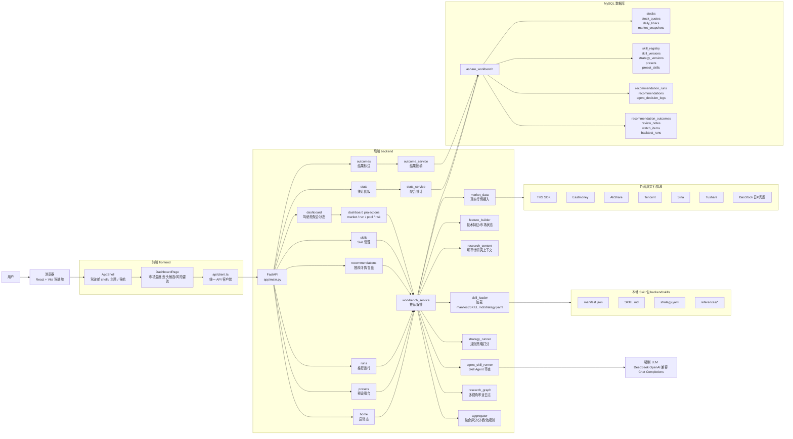
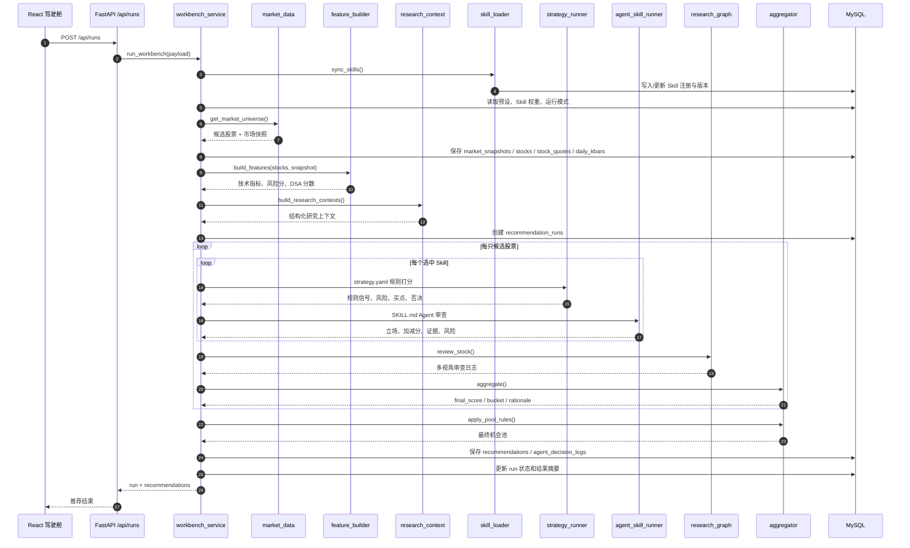
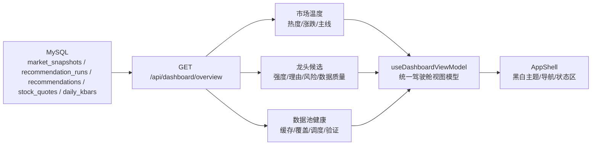
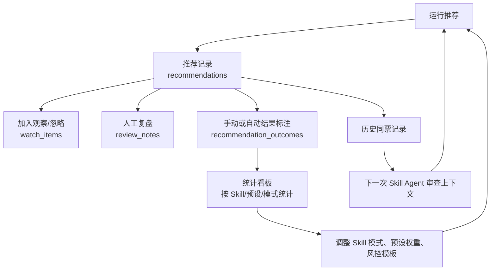

# AShare Shortline System 架构图

## 系统总览

## 推荐运行链路

## 共享因子层、策略层与聚合风控层边界

当前推荐引擎按三层职责拆分，核心目标是让可回测、可解释的事实只计算一次，让不同短线策略只表达自己的取舍，让最终风险控制集中在聚合层完成。

### 共享因子层

涉及文件：`backend/app/services/feature_builder.py`、`backend/app/services/shortline_factors.py`。

- `feature_builder` 负责把报价、日 K、辅助数据池和市场快照合成为稳定特征输入。
- `shortline_factors` 负责计算共享短线增强因子，包括涨停过热、板块梯队完整度、资金共振、20cm 风险闸门。
- 每个共享因子必须声明字段名、计算逻辑、数据来源、缺失数据降级策略，并由测试覆盖。
- 共享因子层只输出可观察或可回测字段，不输出 `buy_signal`、`suggested_position`、`operation_advice` 等买卖判断。
- 数据源默认优先 Tushare 和本地数据池；缺失时只能退化到可回测的行情、量价或代码板块信息，并在解释字段中保留降级说明。

### 策略插件层

涉及文件：`backend/skills/*/strategy.yaml`、`backend/app/engine/skill_loader.py`、`backend/app/engine/strategy_runner.py`。

- `strategy.yaml` 是策略合同，表达股票池、预过滤、阶段、买点、评分、风险规则。
- `skill_loader` 只负责发现和加载插件目录，不内置陈小群、炒股养家、隔夜持股法等具体策略身份。
- `strategy_runner` 只按 YAML 合同对共享字段求值，返回策略信号、证据、风险、买点和策略独立度。
- 陈小群龙头战法、炒股养家大局观、隔夜持股法是普通策略插件样例：它们可以选择同一批共享因子，但权重、阈值和风险解释必须各自写在 YAML 中。
- 新策略接入应通过新增插件目录和 `strategy.yaml` 完成；核心引擎不应为了某个策略 ID 新增分支。

### 聚合风控层

涉及文件：`backend/app/engine/aggregator.py`。

- `aggregator` 负责合并多个策略信号、市场状态、证据质量、Agent 审查和共享因子风险。
- 仓位纪律、最终降档、阻断和解释性输出集中在聚合层处理。
- 聚合结果必须保留 `strategy_signals`、`shortline_factors`、`shortline_factor_explanations`、`score_breakdown`，让前端和复盘能解释“哪个策略支持、哪个因子扣分、聚合为什么降档”。

### 策略专属回测适配

涉及文件：`backend/app/engine/strategy_backtest_adapter.py`、`backend/app/api/runs.py`。

- 通用回测仍由 `backtest_service.run_backtest` 执行。
- 如果某个策略有专属回测或数据补齐动作，应在该策略的 `strategy.yaml` 中声明 `meta.backtest_adapter`。
- `/api/runs/backtest` 只读取策略元数据并分发适配器；核心 API 不直接判断具体策略 ID。

## 后端推荐架构

```mermaid
flowchart LR
  subgraph sources["真实行情源"]
    ths["THS SDK<br/>报价 + 日K"]
    eastmoney["Eastmoney<br/>报价 + 日K"]
    akshare["AkShare<br/>报价 + 日K"]
    tencent["Tencent<br/>报价 + 日K"]
    sina["Sina<br/>报价"]
    tushare["Tushare<br/>报价 + 日K"]
    baostock["BaoStock<br/>日K兜底"]
  end

  subgraph ingestion["行情接入层 market_pool + market_data"]
    quote_router["多源报价采集<br/>并行拉取/失败留痕"]
    raw_quotes["分源原始报价<br/>raw_quotes"]
    merge_quotes["统一报价合成<br/>字段级中位数/冲突检测/质量分"]
    stock_quotes["统一报价缓存<br/>stock_quotes"]
    kline_router["日K缓存优先<br/>不足时逐源刷新"]
    daily_kbars["类型化日K缓存<br/>daily_kbars"]
    candidate_filter["候选过滤<br/>成交额、涨跌幅、ST、流动性等"]
    quality_gate["数据质量门禁<br/>新鲜度、源数量、冲突标记"]
    source_health["数据源健康度<br/>data_source_health"]
    source_config["数据源开关<br/>data_source_config"]
  end

  ths --> quote_router
  eastmoney --> quote_router
  akshare --> quote_router
  tencent --> quote_router
  sina --> quote_router
  tushare --> quote_router

  ths --> kline_router
  eastmoney --> kline_router
  akshare --> kline_router
  tencent --> kline_router
  tushare --> kline_router
  baostock --> kline_router

  quote_router --> raw_quotes
  quote_router --> source_health
  source_config --> quote_router
  raw_quotes --> merge_quotes
  merge_quotes --> stock_quotes
  stock_quotes --> candidate_filter
  candidate_filter --> kline_router
  kline_router --> daily_kbars
  kline_router --> source_health
  source_config --> kline_router
  daily_kbars --> quality_gate
  kline_router --> quality_gate

  subgraph pool["统一候选数据池"]
    market_snapshot["市场快照<br/>涨跌家数、涨停跌停、主线行业、市场状态"]
    stock_pool["候选股票池<br/>报价 + 日K + 行业 + 流动性"]
    feature_pool["特征池<br/>均线、量能、MACD、RSI、支撑压力、风险分"]
    research_context["研究上下文池<br/>quote / kline / features / themes / events / quality / source_trace"]
  end

  quality_gate --> market_snapshot
  quality_gate --> stock_pool
  stock_pool --> feature_pool
  market_snapshot --> feature_pool
  feature_pool --> research_context

  subgraph skill_fanout["多 Skill 审查层"]
    skill_a["Skill A<br/>strategy.yaml 规则 + SKILL.md Agent"]
    skill_b["Skill B<br/>strategy.yaml 规则 + SKILL.md Agent"]
    skill_c["Skill C<br/>strategy.yaml 规则 + SKILL.md Agent"]
    skill_n["更多 Skill<br/>按预设权重启用"]
  end

  research_context --> skill_a
  research_context --> skill_b
  research_context --> skill_c
  research_context --> skill_n

  subgraph decisions["信号与聚合"]
    signals["Skill 信号集合<br/>分数、买点、风控、证据、否决"]
    review["research_graph<br/>多视角审查日志"]
    aggregate["aggregator<br/>加权评分、风险扣分、共识分、市场分"]
    pool_rules["机会池规则<br/>分桶限制、输出数量、近期重复过滤"]
  end

  skill_a --> signals
  skill_b --> signals
  skill_c --> signals
  skill_n --> signals
  signals --> review
  signals --> aggregate
  review --> aggregate
  aggregate --> pool_rules

  subgraph persistence["落库与复盘"]
    runs["recommendation_runs<br/>运行参数和市场快照"]
    recs["recommendations<br/>最终推荐卡片"]
    logs["agent_decision_logs<br/>Skill 审查证据"]
    outcomes["recommendation_outcomes / review_notes / watch_items<br/>结果、复盘、观察"]
  end

  pool_rules --> runs
  pool_rules --> recs
  review --> logs
  recs --> outcomes
```

当前后端推荐主入口支持三档数据源模式：`local_pool` 仅读取本地 `stock_quotes` 和 `daily_kbars`，本地覆盖不足时停止；`local_pool_preferred` 先读本地池，报价不足或日K未覆盖报价日期时刷新外部源并写回本地池；`realtime` 直接访问外部真实行情源。外部源返回的数据会先进入源级采集结果，再合成为类型化本地数据池，并把源数量、字段冲突、缓存状态写进 `data_quality`，供后续 Skill 和聚合器降权使用。`data_source_health` 只记录事实健康度，`data_source_config` 控制报价源/日K源是否参与后续刷新；单个源失败或关闭不会阻塞整体，全部同类源关闭才会停止运行。

## 驾驶舱投影层

## 数据闭环

## 关键边界

- 前端默认进入短线交易驾驶舱，只负责主题、视图模型、状态表达和结果展示，所有推荐逻辑都在后端。
- `workbench_service` 是核心编排层，连接行情、特征、Skill、聚合、落库和复盘。
- 行情层只使用真实数据源；推荐运行可选 `local_pool`、`local_pool_preferred`、`realtime` 三档，不使用模拟数据。
- Skill 有两种执行面：`strategy.yaml` 负责可执行规则，`SKILL.md` 负责真实 LLM Agent 审查和解释；LLM 未配置或调用失败会停止运行。
- 数据库不仅保存推荐结果，也保存 Skill 版本、运行参数、行情快照、Agent 日志和后续结果，方便回测与复盘闭环。
