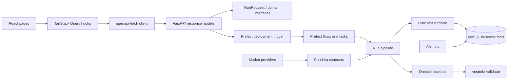
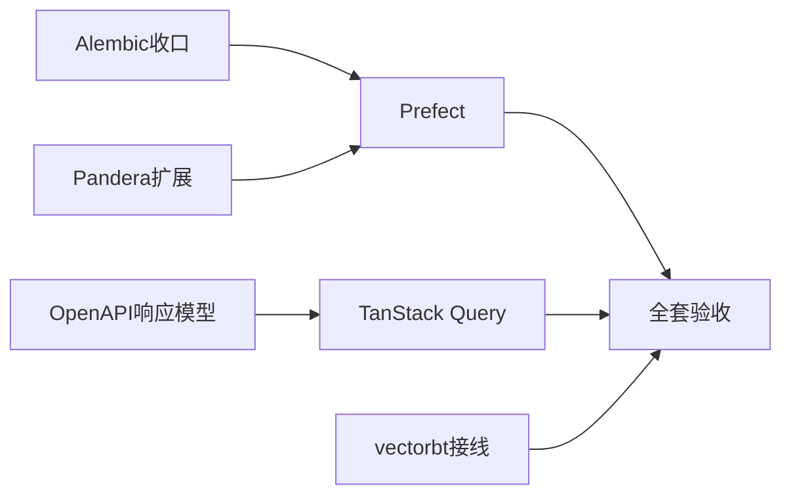

# 开源框架全量切换 Spec

日期：2026-07-30
状态：实施中
适用范围：P0、P1 全量替换，P2 回测交叉验证

## 1. 决策摘要

当前系统是 demo，采用一次性切换，不保留旧实现的运行时兼容、shadow、双写、fallback 或回退开关。

| 优先级 | 现有实现 | 目标框架 | 最终状态 |
|---|---|---|---|
| P0 | 自研数据库迁移 runner | Alembic 1.18.5 | Alembic 是唯一迁移入口 |
| P0 | APScheduler、进程内 queue、后台线程、子进程派发与恢复编排 | Prefect 3.8.0 | Prefect 是唯一调度和执行编排器 |
| P1 | 手写 DataFrame 校验 | Pandera 0.32.1 | provider seam 全部使用 schema contract |
| P1 | 手写 TypeScript 接口类型 | FastAPI OpenAPI + openapi-typescript 7.13.0 + openapi-fetch 0.17.0 | OpenAPI 是跨端契约唯一来源 |
| P1 | 页面内 useEffect/轮询/缓存/刷新 | TanStack Query 5.101.4 | 服务器状态全部由 Query 管理 |
| P2 | 仅领域回测实现 | vectorbt 0.28.5 adapter | 正式结果保留，增加独立复算报告 |

已完成基础提交：

| 提交 | 内容 |
|---|---|
| `38e7d40` | Alembic baseline 和启动接管 |
| `e5fec8b` | daily/stk_factor Pandera contract |
| `a5c3a40` | vectorbt 交叉验证 interface |
| `2bd8e2f` | Query Provider 和 OpenAPI 类型生成基础设施 |

## 2. 不可破坏的领域语义

框架替换不能删除或接管以下领域事实：

- `RunRequest` 是所有推荐入口唯一的 canonical 输入。
- `RunStateMachine` 是 RecommendationRun 状态合法性的唯一来源。
- MySQL 中的 RecommendationRun、checkpoint、revision、lease、side effect key 和推荐结果是业务事实源。
- Prefect 状态只描述编排执行，不替代业务状态。
- 策略筛选由 `strategy.yaml` 自主定义；全局只保留 ST、停牌、无数据等硬过滤。
- 回测必须保留 A 股 T+1、涨跌停、未成交确认、成本、动态退出和版本快照语义。
- 正式推荐、experiment 和 backtest 的统计范围不能因框架切换而改变。

## 3. 共享工程约束

- Python 使用项目 `.venv`。
- 新测试通过公开 interface 验证行为，不测试框架内部实现。
- 每个工作包只修改自己的文件集合；共享文件见第 11 节所有权表。
- 不修改用户当前未提交的 `AppShell.tsx`、`HistoryPage.tsx`、`RecommendationDetailCard.tsx` 和 self-improve 文件，除非先确认其改动已合并。
- 新增凭据只能通过环境变量；日志、OpenAPI、Prefect 参数和生成文件不得含 token、password、连接串。
- 不使用 `Courier` 或 `Courier New`。
- 每个工作包独立 commit，commit 前运行 `git diff --check`。

## 4. 目标架构



## 5. 工作包 A：Alembic 完成收口

### 5.1 当前状态

`init_db()` 已调用 `upgrade_database()`；空库创建完整 ORM schema，已有 demo 库 stamp 为 `0001_demo_baseline`。

### 5.2 剩余工作

- 从生产导入路径移除 `app.db.migrations.run_migrations`。
- 将迁移健康状态移至 `app.db.alembic_runtime` 或独立通用 health module，不能再依赖旧 `MigrationError` 类型。
- 删除 `SchemaMigration` ORM model 和运行期 `schema_migrations` 查询。
- 将 auxiliary snapshot 等检查改为 Alembic revision 或实际 schema capability 检查。
- 删除旧 runner、contract、preflight、schema inventory、versions 及只测试旧 runner 的测试。
- 对用户未提交的 V031：先确保其表已在 ORM metadata 中，再由 Alembic baseline 接管；不要迁移那份旧 migration 文件。
- 新增下一条真实 Alembic revision 测试，证明 baseline 后可 forward upgrade。

### 5.3 验收

- `rg "MigrationRunner|schema_migrations|run_migrations" backend/app` 无运行期命中。
- 空 SQLite 升级到 head 后关键表存在。
- 当前 MySQL 执行 upgrade 后 `alembic current` 为 head。
- 重复 upgrade 是 no-op。
- FastAPI health 返回 Alembic revision 和状态。

## 6. 工作包 B：Prefect 全量编排

### 6.1 范围

Prefect 接管：

- 所有数据库 ScheduledTask 的 cron 调度。
- 手动任务触发。
- RecommendationRun 派发。
- 策略曝光补跑。
- 盘后数据同步与 formal 推荐。
- Outcome 结算、数据健康修复、辅助数据修复、矩阵任务和安全网。
- retry、timeout、并发限制、日志和任务运行观察。

删除 APScheduler、`BackgroundRunDispatcher`、daemon thread 手动任务、固定 sleep stagger 和 startup 补跑线程。

### 6.2 module 划分

```text
backend/app/orchestration/
  contracts.py        # FlowRequest / FlowResult / stable task ids
  deployments.py      # 从 ScheduledTask 构建 Prefect deployments
  flows/
    recommendation.py
    postclose.py
    exposure.py
    outcome.py
    remediation.py
    matrix.py
  tasks/
    runs.py            # 调用现有 Run pipeline interface
    market_data.py
    outcomes.py
    remediation.py
  repository.py       # ScheduledTask/Run 与 Prefect id 关联
backend/scripts/run_prefect_server.py
backend/scripts/run_prefect_worker.py
prefect.yaml
```

### 6.3 公开 interface

```python
schedule_all_enabled_tasks() -> DeploymentSyncResult
trigger_scheduled_task(task_id: str, trigger_source: str) -> OrchestrationRunRef
trigger_recommendation(request: RunRequest) -> OrchestrationRunRef
get_orchestration_run(run_id: str) -> OrchestrationRunView
```

FastAPI、CLI 和其他 flow 只能使用这些 interface，不得直接 import Prefect client。

### 6.4 状态关系

| Prefect | ScheduledTaskRun | RecommendationRun |
|---|---|---|
| Scheduled | queued | 未创建或 queued |
| Running | running | 由领域 interface 迁移到 running |
| Completed | completed/partial | 必须独立为领域合法终态 |
| Failed/Crashed | failed | 由 worker/watchdog 的领域动作处理 |
| Cancelled | cancelled | 通过显式 cancel interface 传播 |

禁止根据 Prefect Completed 直接把 RecommendationRun 写成 completed。

### 6.5 幂等与并发

- 每次业务任务有稳定 `business_run_key`，数据库唯一索引保证至多一个业务记录。
- Prefect retry 采用至少一次语义；task 进入副作用前先 claim 幂等键。
- 全市场扫描 work pool concurrency 为 1。
- 网络型 provider task 可使用单独 work pool，但必须服从 Tushare transport 限流。
- 同一 ScheduledTask 在前一业务运行未结束时不创建第二个运行。

### 6.6 直接切换步骤

1. 提取 `scheduler_service.py` 内业务函数，使其不依赖 APScheduler/thread。
2. 用 flow/task 包装公开业务 interface。
3. 建 Prefect server、worker、deployment 启动脚本。
4. API/CLI 手动入口改为 `trigger_scheduled_task()`。
5. FastAPI startup 不再启动 scheduler、worker 或补跑线程。
6. 删除 APScheduler 依赖和全部旧调度实现。
7. 更新 `dev.sh`、README 和 launchd 示例，使 backend、Prefect server、worker 为三个显式进程。

### 6.7 测试

- 每种 task type 至少一个 flow 集成测试。
- 重复 trigger 只产生一个业务运行。
- task retry 不重复 RecommendationRun。
- worker 重启后已有 MySQL Run 能继续收敛。
- 部分子任务失败产生 partial，不冒充 completed。
- cancel 通过 `RunStateMachine`，不直接写状态字符串。
- FastAPI 重启不会创建第二个 worker。

### 6.8 验收

- `rg "APScheduler|BackgroundScheduler|BackgroundRunDispatcher|threading.Thread" backend/app` 无编排用途命中。
- `requirements.txt` 删除 APScheduler，固定 `prefect==3.8.0` 和兼容的 FastAPI 版本。
- 所有 enabled ScheduledTask 均对应 Prefect deployment。
- 手动运行、cron 运行和 CLI 运行走同一 flow interface。

## 7. 工作包 C：Pandera 全数据源契约

### 7.1 当前状态

`daily` 与 `stk_factor` 已校验 required columns、代码/日期格式和 `(ts_code, trade_date)` 唯一性。

### 7.2 扩展 schema

至少覆盖：

- `daily_basic`
- `stk_factor_pro`
- `cyq_perf`
- `moneyflow`
- `stk_limit`
- `index_daily`
- 实时 quote 和分钟行情
- auxiliary provider 的 holder、pledge、survey、block trade 数据

每个 schema 声明 required/optional 列、nullable、数值范围、日期格式和自然唯一键。空结果必须保留声明列；上游返回非空但缺 schema 时立即失败。

### 7.3 interface

```python
validate_market_frame(kind: MarketFrameKind, frame: pd.DataFrame) -> pd.DataFrame
```

所有 provider adapter 在 normalization 前调用；调用方不得复制列检查。

### 7.4 验收

- 所有推荐主链 DataFrame 都穿过 Pandera schema。
- schema drift 返回带 `kind`、失败列和 provider 的稳定错误。
- 数据健康页能按 contract violation 分类统计。
- contract 测试覆盖缺列、错误类型、重复键、错误日期、合法空结果。

## 8. 工作包 D：OpenAPI 唯一跨端契约

### 8.1 当前状态

已有 `export_openapi.py`、`npm run generate:api` 和生成的 `schema.generated.ts`，但大量响应仍被推断为未知或宽泛对象。

### 8.2 后端改造

- 为 107 个路由逐项声明 request model、response model 和稳定 error model。
- 禁止 endpoint 返回未声明的任意 dict。
- 先建立共享 envelope：分页、任务运行、错误、健康状态。
- Pydantic model 按领域放到 `backend/app/schemas/`，不能复制 ORM model。
- OpenAPI operationId 必须稳定且唯一。
- CI 执行 OpenAPI 导出后检查生成文件无 diff。

### 8.3 前端改造

- 建 `src/api/generatedClient.ts`，唯一职责是配置 `openapi-fetch`、鉴权和错误映射。
- 删除 `client.ts` 中已生成的 endpoint 方法和 `types.ts` 中重复 response 类型。
- 页面不能使用 `as T` 强制声称响应类型。
- UI-only 类型保留在局部文件；跨端类型只能从 `schema.generated.ts` 派生。

### 8.4 迁移顺序

1. runs/recommendations
2. home/dashboard
3. scheduler/admin/data health
4. records/outcomes/metrics
5. strategies/presets/skills
6. data sources/pool/backtests

每组完成后删除对应手写类型，不能长期双轨。

### 8.5 验收

- 所有路由有明确成功 response schema。
- OpenAPI 无重复 operationId。
- `rg "return .* as [A-Z]" frontend-v2/src/api` 无响应断言。
- `types.ts` 只剩 UI/组合类型，体积显著下降。
- `npm run generate:api && npm run build` 通过且生成结果稳定。

## 9. 工作包 E：TanStack Query 全量服务器状态

### 9.1 规则

- Query 管理所有 GET 服务器状态、缓存、轮询、取消和刷新。
- Mutation 管理所有写操作并通过 query key 精确 invalidation。
- Zustand 只保留 UI 状态，不缓存服务端对象。
- 页面不再直接管理 `loading/error/data` 三元状态。
- 禁止页面自行 `setInterval`/递归 `setTimeout` 做请求轮询。

### 9.2 query key factory

```typescript
export const queryKeys = {
  home: () => ["home"] as const,
  run: (id: string) => ["runs", id] as const,
  runFunnel: (id: string) => ["runs", id, "funnel"] as const,
  records: (filters: RecordFilters) => ["records", filters] as const,
  dataHealth: () => ["data-health"] as const,
  scheduler: () => ["scheduler"] as const,
  pool: () => ["pool"] as const,
};
```

集中放在 `src/api/queryKeys.ts`，禁止各页面拼字符串 key。

### 9.3 hooks

按领域建立：

```text
src/api/queries/useHomeQuery.ts
src/api/queries/useRunQuery.ts
src/api/queries/useRecordsQuery.ts
src/api/queries/useDataHealthQuery.ts
src/api/queries/useSchedulerQueries.ts
src/api/queries/usePoolQueries.ts
src/api/mutations/*
```

Run 轮询规则：queued/running 时 `refetchInterval`，终态返回 false。DataHealth remediation 和 Matrix 同理。

### 9.4 页面迁移范围

- HomePage
- RunDetailPage 及 RunFunnel/RunStockScore 子视图
- MatrixPage
- RecordsPage
- HistoryPage（待用户当前改动合并后）
- PoolPage
- DataHealthPage
- SchedulerTasksSection
- ModelRoutesSection、DataSourcesSection、PresetsSection、SkillsCatalogPanel

### 9.5 验收

- `rg "setInterval|pollRef|activePollController" frontend-v2/src` 无网络轮询命中。
- 页面卸载自动取消请求。
- mutation 成功后只刷新相关 query。
- 同一资源多个视图共享缓存，不重复请求。
- 前端现有单元测试和生产 build 通过。

## 10. 工作包 F：vectorbt 交叉验证接线

### 10.1 当前状态

已有 `cross_validate_signals()`，可比较 domain 与 vectorbt 的总收益、绝对差异和交易数。

### 10.2 剩余工作

- 从领域 backtest result 投影标准 `ValidationSignalStream`：close、entry、exit、fees、slippage。
- 明确无法由 vectorbt 表达的事件：涨跌停无法成交、T+1、动态止盈状态等，并在报告中列为 semantic exclusions。
- 对可表达子集逐交易比较 entry index、exit index、gross/net return。
- `BacktestResult` 增加可选 `cross_validation`，不改变正式结论。
- CLI/研究报告支持 `--cross-validate vectorbt`。
- 差异超过 tolerance 时验证失败并输出首个 divergence，不修改领域结果。

### 10.3 报告

```python
CrossValidationReport(
    passed,
    domain_total_return,
    vectorbt_total_return,
    absolute_difference,
    closed_trade_count,
    compared_trade_count,
    semantic_exclusions,
    first_divergence,
)
```

### 10.4 验收

- 无特殊交易限制的固定样本逐交易一致。
- 成本和滑点在两边使用同一 policy。
- 遇到 T+1/涨跌停差异时报告 exclusion，而不是伪造一致。
- 交叉验证失败不覆盖或删除领域 backtest artifact。

## 11. 多 agent 文件所有权

建议同时分派 5 个 agent，避免交叉编辑：

| Agent | 工作包 | 独占文件范围 |
|---|---|---|
| A | Alembic 收口 | `backend/alembic/**`、`backend/app/db/**`、迁移测试 |
| B | Prefect | `backend/app/orchestration/**`、`scheduler_service.py`、`runs/queue.py`、启动脚本、调度测试 |
| C | Pandera | `dataframe_contracts.py`、provider adapters、contract 测试 |
| D | OpenAPI | `backend/app/schemas/**`、`backend/app/api/**`、生成 client/schema |
| E | TanStack Query | `frontend-v2/src/api/queries/**`、`mutations/**`、页面迁移 |
| F | vectorbt | `backend/app/services/backtest/**`、backtest CLI 和验证测试 |

共享文件的合并顺序：

1. `backend/requirements.txt`：A → C → B → F。
2. `frontend-v2/package*.json`：D 先，E 后。
3. `backend/app/main.py`：B 独占；D 只改 route models，不改 startup。
4. `frontend-v2/src/types.ts`：D 独占；E 从生成类型引用，不自行删除类型。
5. 用户当前脏文件先由用户变更落地，再交给 E。

## 12. 依赖图与实施顺序



可并行：A、C、D、F。B 等待 A/C 的共享后端基线；E 可先迁未冲突页面，但最终等待 D 的生成 client。

## 13. 总体验收命令

```bash
cd backend
.venv/bin/python -m pytest -q
.venv/bin/python -m alembic current
.venv/bin/python -m alembic upgrade head
.venv/bin/python -m scripts.export_openapi

cd ../frontend-v2
npm run generate:api
npm test
npm run build
```

架构静态检查：

```bash
rg "APScheduler|BackgroundScheduler|BackgroundRunDispatcher" backend/app
rg "MigrationRunner|schema_migrations" backend/app
rg "setInterval|activePollController|pollRef" frontend-v2/src
rg "response_model=" backend/app/api
git diff --check
```

预期：前三个 `rg` 不应再命中对应旧基础设施；所有业务路由都应能证明存在响应模型，可通过 AST 检查代替简单计数。

## 14. 完成定义

只有同时满足以下条件，才能宣称“P0-P1 全部替换完成”：

- FastAPI 启动不 import 或启动 APScheduler、自研 dispatcher 或 migration runner。
- 所有定时和手动后台任务都由 Prefect deployment/flow 执行。
- 所有推荐主链 provider DataFrame 都有 Pandera contract。
- 所有 FastAPI 路由成功响应都有 Pydantic schema。
- 前端跨端类型全部来自生成 OpenAPI schema。
- 所有页面服务器状态和轮询由 TanStack Query 管理。
- vectorbt 已接入至少一个真实领域 backtest artifact 并生成差异报告。
- 后端全套测试、前端测试和生产构建通过。
- README、开发启动和运维说明与新架构一致。

任何仅“安装依赖”“增加 Provider”“生成未知类型”或“保留旧路径作为默认”的状态都不算完成。
